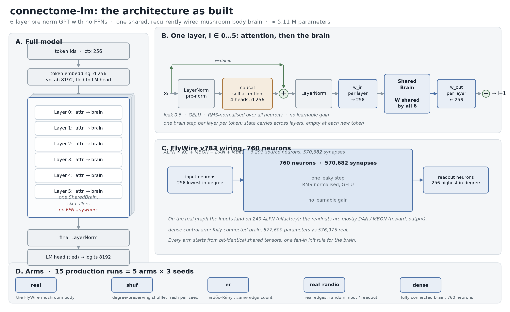
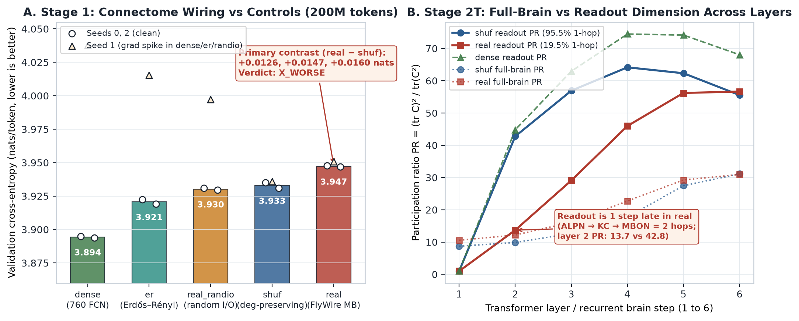
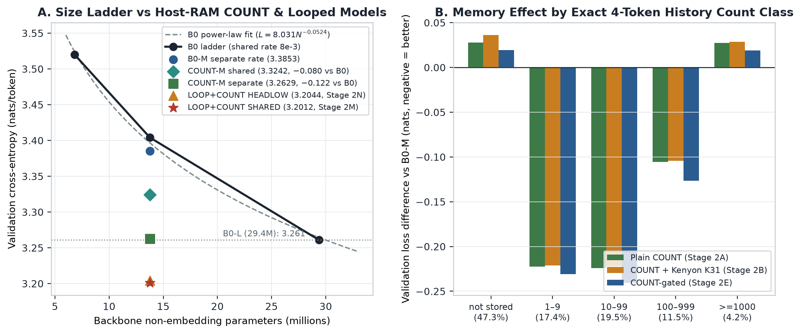
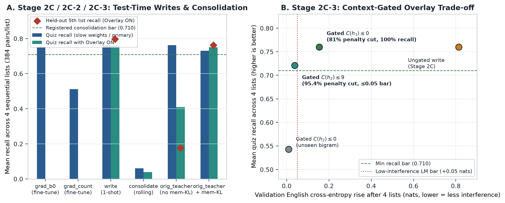
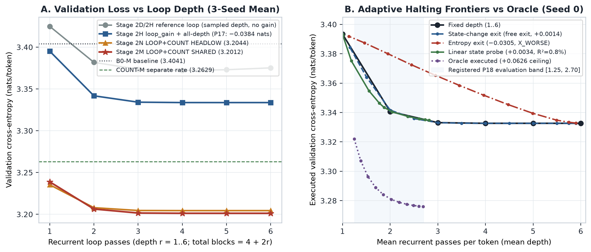
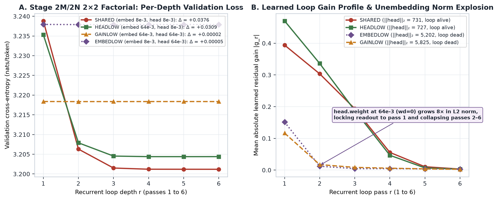

# From Connectome Wiring to Counted Memory and Recurrent Depth: Pre-Registered Tests of *Drosophila* Mushroom-Body Principles in Small Language Models

**Nate Farrow (Independent Researcher)**  
*Date: 17 November 2026 · Repository: `connectome-lm` (commits `feb582e`–`c9e496d`)*

---

## Abstract

Biological neural circuits inspire machine learning both as literal connectivity graphs and as algorithmic motifs—sparse random expansion, homeostatic competition, fast associative memory, and adaptive recurrent computation. Across **16 pre-registered stages** (101 production training and evaluation runs, **25 registered predictions `P1`–`P25`**, and a **218-mutant automated test audit**), we systematically test where *Drosophila* mushroom-body principles help—and where they fail—in small language models (5M–29M parameters trained on 200M tokens of FineWeb-Edu).

First, in **Stage 1** and **Stage 2T**, replacing a 6-layer transformer's feed-forward networks with a shared recurrent reservoir wired like the adult *Drosophila* mushroom body (FlyWire v783: 6,293 neurons, 570,682 synapses) performs **reliably worse** than degree-preserving random shuffles (`real − shuf = +0.0126, +0.0147, +0.0160` nats/token, verdict `X_WORSE`) and dense or Erdős–Rényi controls (`dense < er < real_randio ≈ shuf < real`). While the real connectome has half the effective rank of its shuffles (`0.48×`), its full-brain activity participation ratio matches the shuffles (`real ÷ shuf = 1.00`, refuting `P1`); instead, its three-layer anatomical routing ($\text{ALPN} \to \text{KC} \to \text{MBON}$) leaves only **19.5%** of readout neurons one hop from an input (versus **95.5%** in degree-preserving shuffles), delaying readout dimensionality by one recurrent step.

Second, in **Stages 2.0–2B and 2E–2K2**, we replaced literal connectome wiring with a counted host-RAM $n$-gram memory (**COUNT**, orders 2–5 over 881M tokens, 5.15 GiB host RAM, zero GPU parameters) and test a mushroom-body similarity backoff (**Kenyon hash**: fixed PPMI token codes, sparse random expansion $K=31$, homeostatic $k$-winners-take-all into $4.19\times 10^6$ buckets). Adding **leave-one-out** count subtraction during training is essential (preventing a **+0.84 nat** validation collapse from target leakage). On equally tuned separate learning rates (Muon `8e-3` on block matrices, AdamW `64e-3` on embeddings and head), plain COUNT lowers 13.8M-parameter (`Size M`) validation loss by **−0.1224 nats** (`3.3853 → 3.2629`, `X_BETTER`, `P12`–`P13`), matching a **29.4M-parameter (`Size L`)** baseline at **+3.4%** step time and zero additional VRAM. However, while the Kenyon similarity backoff improves an offline $n$-gram model on unseen and rare histories (`+0.0151` and `+0.0130` nats, `P5` supported), that gain **vanishes inside the neural network** (`+0.0046` nats vs plain COUNT, `NO_MEANINGFUL_DIFFERENCE`, `P4` refuted). Likewise, learned per-order/per-bin gates and scalar controls (`Stages 2E, 2K, 2K2`) fail to beat plain COUNT once embeddings and the unembedding head train at `64e-3` (`P19`–`P20` refuted).

Third, in **Stages 2C, 2C-2, and 2C-3**, we test complementary learning systems (CLS) using gradient-free one-shot count writes (`Overlay`) followed by KL-anchored replay consolidation into slow weights. One-shot writes learn 4 sequential lists of 384 cue–answer pairs (`1,536` pairs) with **0.760 recall** and **zero catastrophic forgetting** (`backward transfer = 0.000` vs `−0.330` and `−0.651` for gradient fine-tuning, `P7` supported). We show that standard sequential replay consolidation collapses (`0.061` recall) due to **teacher drift** (`Stage 2C-2`, `+0.704` recall recovery with an untouched teacher) and **overlay-channel drift** (`Stage 2C-3`, `H1a` supported: consolidating with the overlay off de-calibrates the backbone's memory-reading pathway, dropping recall on an unseen 5th list from `0.797` to `0.177`). Adding a **memory-on KL consistency loss** (`memory_kl_weight = 1.0`) restores both memory-off (`0.731`) and memory-on (`0.750`) consolidated recall while preserving unseen-list reading (`0.763`). Furthermore, gating test-time overlay writes by stored $n$-gram history counts (`GatedOverlay`) preserves **100% of quiz recall (`0.7602`) while cutting English validation loss interference by 81.0%** at $C(h_3) \le 0$, and cuts interference by **95.4% (`+0.038` nats)** at $C(h_2) \le 9$.

Fourth, in **Stages 2D, 2H, 2I, and 2L–2N**, we study recurrent depth (`LoopGPT`: 2 prelude blocks, a shared 2-block core looped $r \in \{1,\dots,6\}$ times, 2 coda blocks). On token-level optimal stopping, the exact oracle depth scales affinely with log-effort (`P9` supported, $R^2 = 0.957\text{–}0.993$) and beats fixed depth by **0.0626 nats** at equal mean depth, but **no deployable halting rule** (state-change, logit entropy, logit margin, or ridge-regression state probes) beats fixed depth by the `0.01`-nat threshold (`P18` refuted; linear probes explain `< 1%` of next-pass benefit variance, and entropy exiting is `X_WORSE` by `−0.0305` nats). Training with a **learned per-pass per-channel residual gain (`loop_gain`) and an all-depth loss** (`Stage 2H`, `P17` supported) lowers validation loss by **−0.0384 nats** (`3.3720 → 3.3336`) and learns to damp passes 5–6 to zero automatically (`|g_r|`: `0.43, 0.31, 0.20, 0.06, 0.01, 0.002`), so fixed depth 3 captures **99.2%** of the 6-pass gain at half the recurrent passes. Finally, when combining `LoopGPT` with `COUNT` (`Stages 2L–2N`), we discover and isolate a sharp optimizer pathology: training under the separate-rate recipe (`AdamW 64e-3`) renders all extra loop passes completely inert (`loop benefit < 0.00005` nats). Through a pre-registered `2×2` factorial (`Stages 2M–2N`, `P22`–`P25`), we prove that **`head.weight` (the untied unembedding matrix) at `64e-3` with zero weight decay explodes 7–8× in L2 norm (`>5,200` vs `~730`)**, locking the shared readout to pass 1 and forcing `loop_gain` to shut passes 2–6 off. Keeping `head.weight` at `8e-3` (`SHARED` and `HEADLOW`) revives the loop (`+0.0376` and `+0.0309` nats loop benefit) and achieves **`3.2012` nats** (`3.2015` at depth 3)—a **−0.2029 nat** total reduction below the `B0-M` baseline (`3.4041`) at identical GPU parameter count.

---

## 1. Introduction

Small language models trained on consumer hardware face two hard walls: **GPU memory (VRAM)** and **parameter capacity**. Biological nervous systems—such as the *Drosophila melanogaster* mushroom body (MB)—operate under severe physical constraints using three recurring architectural motifs:
1. **Specific synaptic connectivity vs sparse random expansion:** Sensory projection neurons (ALPNs) project onto a larger population of Kenyon cells (KCs) governed by global anterior paired lateral (APL) inhibition and homeostatic firing-rate thresholds, which in turn project to mushroom body output neurons (MBONs) modulated by dopaminergic neurons (DANs) (Dasgupta et al., 2017; Litwin-Kumar et al., 2017).
2. **Complementary fast associative writes and slow consolidation:** KCs write one-shot associations into KC$\to$MBON synapses without catastrophic overwriting of prior associations, while offline replay consolidates memories into slower cortical/backbone representations (McClelland et al., 1995; Bennett et al., 2021).
3. **Recurrent iterative refinement:** Shared circuit blocks process inputs over multiple recurrent passes when single-pass processing is insufficient.

In this work, we ask a pragmatic question: **Which of these principles genuinely improve a transformer language model at the 5M–29M parameter scale on a single 4–8 GB GPU, when subjected to strict pre-registration, paired multi-seed decision rules, and automated mutation auditing?**

### 1.1 Summary of Contributions

1. **Refuting literal connectome superiority (`Stage 1` & `Stage 2T`):** Using the complete FlyWire v783 mushroom-body connectome (`6,293` neurons, `570,682` directed weighted synapses) as a shared recurrent layer inside a 6-layer transformer loses to degree-preserving shuffled graphs on every seed (`+0.0144` nats mean penalty, `X_WORSE`). Mechanistic analysis (`Stage 2T`) refutes the hypothesis that low connectivity effective rank halves activity dimension (`P1` refuted: full-brain participation ratio `real ÷ shuf = 1.00`) and reveals an anatomical **one-step readout delay**: because the biological graph routes $\text{ALPN} \to \text{KC} \to \text{MBON}$ over two hops, only `19.5%` of readout neurons receive 1-hop input (vs `95.5%` in shuffles).
2. **Counted host-RAM memory and leave-one-out leakage (`Stages 2.0, 2A, 2F, 2G`):** Adopting COUNT (Magnusson et al., 2026)—an exact $n$-gram continuation count table in host RAM projected through the model's own unembedding matrix `head.weight`—yields a **−0.1224 nat** improvement over an equally tuned `13.8M`-parameter transformer (`3.3853 → 3.2629`, `X_BETTER`), equivalent to **1.57×–2.1×** backbone parameters at zero extra VRAM and `+3.4%` step time. We demonstrate that when the count table corpus (`881M` tokens) overlaps the training stream (`200M` tokens), **online leave-one-out count subtraction** is mandatory: omitting it causes severe target memorisation (training loss `2.397` vs validation loss `4.161`, a **+0.84 nat** degradation).
3. **Boundary of similarity backoffs and learned memory gates (`Stages 2B-0, 2B, 2E, 2K, 2K2`):** A mushroom-body fly-hash backoff (`Kenyon K31`) improves held-out offline $n$-gram cross-entropy on unseen 4-token histories by `0.0151` nats (`2B-0`, confirming Litwin-Kumar et al.'s $K$-saturation prediction `P5`), but adds **zero benefit inside the neural network** (`+0.0046` nats worse than plain COUNT, `2B`). Similarly, learned per-order/per-bin gates (`1,568` params) and scalar multipliers help slightly on under-tuned shared learning rates (`−0.0111` nats, `2E`) but **degrade or tie with plain COUNT** once the unembedding head trains at its optimal `64e-3` AdamW rate (`2K`, `2K2`).
4. **Solving teacher drift, overlay-channel drift, and language interference in test-time count writes (`Stages 2C, 2C-2, 2C-3`):** One-shot count writes store `1,536` pairs across 4 sequential lists with `0.760` recall and `0.000` backward forgetting (`P7`). We diagnose two distinct failure modes in KL-replay consolidation—**rolling-teacher drift** (`2C-2`) and **overlay-channel de-calibration** (`2C-3`, `H1a`)—and fix both with an untouched teacher plus a **memory-on KL consistency loss** (`0.750` memory-on recall, `0.763` unseen-list recall). We then introduce **context-gated overlay writes (`GatedOverlay`)**, which suppress 1-token test-time writes when higher-order $n$-gram context is present in the corpus table, cutting English validation loss interference by **81.0% (`+0.154` nats) at 100% recall** or **95.4% (`+0.038` nats) at `0.721` recall**.
5. **Recurrent depth, halting limits, and the unembedding-norm collapse (`Stages 2D, 2H, 2I, 2L, 2M, 2N`):** We verify DeepSeek's affine effort law on exact token-level optimal recurrent depth (`P9`), stabilize looped training via a learned per-pass residual gain (`loop_gain`) plus all-depth supervision (`P17`, `−0.0384` nats), and show that standard causal halting signals (entropy, margin, state-change, and linear state probes) explain `< 1%` of next-pass benefit variance and cannot close the `0.0626`-nat oracle gap (`P18` refuted). Finally, we resolve why separate-rate optimization (`Muon 8e-3 / AdamW 64e-3`) completely kills recurrent depth (`Stage 2L`): a `2×2` factorial (`Stages 2M–2N`, `P22`–`P25`) proves that training the untied `head.weight` at `64e-3` with zero weight decay causes an **8× L2 norm explosion (`5,202–5,825` vs `~730`)** that locks the shared readout to pass 1. Restraining `head.weight` to `8e-3` revives the loop and achieves **`3.2012` nats** (`Stage 2M` `SHARED`).

---

## 2. Methodology, Pre-Registration Discipline, and Mutation Auditing

A central goal of this study was to eliminate researcher degrees of freedom, selective reporting, and silent implementation bugs.

### 2.1 Pre-Registration Protocol and Decision Rules

Every experimental stage (`Stage 1`, `Stage 2.0`, `Stages 2A` through `2N`) was governed by a committed `PREREG_*.md` file whose SHA-256 digest and git commit hash were recorded inside every run's `results.json` output (`git_dirty: false` enforced by the analysis scripts).
- **Smallest Effect Size of Interest (SESOI):** Fixed before Stage 1 and confirmed in Stage 2.0 (`2 × SD(B0-M) = 0.0054` nats, so the pre-set floor binds) at $\text{SESOI} = 0.01\text{ nats/token}$.
- **Paired multi-seed verdict rule (`src/clm/analyze.py`):** Given paired seeds $s \in \{0, 1, 2\}$ (or $s \in \{0,\dots,4\}$ for 5-seed extensions) and per-seed difference $d_s = L_X(s) - L_Y(s)$ (where lower loss is better):
  - **`X_BETTER`**: $\text{mean}(d) \le -0.01$ and $\forall s,\; d_s < 0$.
  - **`X_WORSE`**: $\text{mean}(d) \ge +0.01$ and $\forall s,\; d_s > 0$.
  - **`NO_MEANINGFUL_DIFFERENCE`**: $|\text{mean}(d)| < 0.01$ and $\forall s,\; |d_s| < 0.02$.
  - **`INCONCLUSIVE`**: any other finite outcome.
- **Blind execution:** Validation losses of primary arms were never read before a stage's driver completed all registered runs (with a single logged conduct slip on seed 0 of Stage 2M `GAINLOW` recorded in `notes/deviations.md`, commit `39248b3`, which changed no code, config, or run). All post-commit crash fixes or hardware restarts were logged with commit hashes in `notes/deviations.md`.

### 2.2 Automated Mutation Testing (`218 / 218` Mutants Killed)

Standard unit tests verify that code runs, not that tests would fail if a subtle scientific bug were introduced (e.g., off-by-one leave-one-out subtraction, validation documents leaking into count tables, stale prefetch buffers, or mis-routed optimizer parameter groups). Alongside the 350+ unit tests in `tests/`, we maintained `scripts/mutation_audit.py`, which programmatically plants **218 single-line bugs (`M1`–`M222`, with 4 retired indices)** across `src/clm/` and requires the targeted pytest suite to fail by `AssertionError` on every single mutant, while passing two harness controls (`C1` unmutated pass, `C2` synthetic assertion failure). All 218 mutants were killed prior to the final runs.

---

## 3. Part I: Literal Connectome Wiring vs Controls (Stage 1 & Stage 2T)

### 3.1 Stage 1 Architecture and Experimental Design

Stage 1 tested whether replacing the feed-forward networks (FFNs) of a 6-layer pre-norm GPT (`d_model = 256`, `4` heads, `ctx = 256`, BPE vocabulary `8,192`, tied embeddings, `~5.11M` total parameters) with a single **shared recurrent reservoir (`SharedBrain`)** wired according to the adult *Drosophila* mushroom body improves validation cross-entropy over degree-preserving random rewirings at equal parameters, tokens, data order, and fan-in initialisation.

In each transformer layer $l \in \{0,\dots,5\}$, after causal self-attention and residual addition, a per-layer projection $W_{\text{in}}^{(l)}$ writes the 256-dim residual stream into the 256 lowest in-degree brain neurons. The 6,293-neuron brain executes one leaky recurrent step ($\text{leak} = 0.5$, GELU activation, RMS-normalised across all neurons, no learnable gain), persisting its state across layers $0 \to 5$ within each token (and resetting between tokens). A per-layer readout $W_{\text{out}}^{(l)}$ projects the 256 highest in-degree neurons back into the residual stream.

Five arms (`3` seeds each, `15` runs total, `199,999,488` training tokens of FineWeb-Edu shard 000 on 2× RTX 3090) were evaluated on the first `2,097,152` validation tokens:
1. **`real`**: FlyWire v783 mushroom body (ALPN + KC + MBON + DAN + MBIN: `6,293` neurons, `570,682` synapses). On this graph, the 256 lowest in-degree inputs land on `249` olfactory ALPNs, and the 256 highest in-degree readouts are predominantly DAN/MBON output neurons.
2. **`shuf`**: Degree-preserving Maslov–Sneppen shuffle (fresh per seed, exact in/out degree sequence preserved, `100%` reachability verified).
3. **`er`**: Directed Erdős–Rényi random graph with identical neuron and edge counts (`6,293` neurons, `570,682` edges).
4. **`real_randio`**: Exact `real` synaptic edges, but with 256 input and 256 readout neurons chosen uniformly at random.
5. **`dense`**: Fully connected recurrent brain of `760` neurons (`577,600` synapses vs `576,975` brain parameters in `real`).

### 3.2 Stage 1 and Stage 2T Results

| Arm | Neurons / Synapses | Seed 0 | Seed 1 | Seed 2 | Clean Mean (Seeds 0, 2) | All-Seed Mean | Full-Brain PR (Layer 6) | Readout PR (Layers 2, 3, 6) | 1-Hop Input $\to$ Readout Share |
|---|---|---:|---:|---:|---:|---:|---:|---:|---:|
| **`dense`** | 760 / 577,600 | 3.8949 | 4.0377* | 3.8939 | **3.8944** | 3.9422 | 57.2 | 44.8, 62.9, 68.0 | 100.0% |
| **`er`** | 6,293 / 570,682 | 3.9224 | 4.0155* | 3.9190 | **3.9207** | 3.9523 | 43.9 | 42.3, 56.4, 55.9 | 99.2% |
| **`real_randio`** | 6,293 / 570,682 | 3.9309 | 3.9973* | 3.9295 | **3.9302** | 3.9526 | 36.9 | 41.0, 47.3, 48.3 | 91.4% |
| **`shuf`** | 6,293 / 570,682 | 3.9350 | 3.9359 | 3.9309 | **3.9329** | 3.9339 | 31.1 | 42.8, 56.9, 55.5 | 95.5% |
| **`real`** | 6,293 / 570,682 | 3.9476 | 3.9507 | 3.9468 | **3.9472** | 3.9484 | 30.9 | **13.7, 29.1**, 56.6 | **19.5%** |

*\*Note: On Seed 1, `er-1`, `real_randio-1`, and `dense-1` experienced finite mid-training gradient spikes (max grad norms 38, 83, 283), making secondary contrasts across all 3 seeds formally `INCONCLUSIVE`; `real` and `shuf` were clean on all 3 seeds.*

**Key findings from Stage 1 and Stage 2T:**
1. **Primary contrast (`real` vs `shuf`) is `X_WORSE`:** On all three seeds, the biological connectome is worse than its degree-preserving shuffle by **+0.0126, +0.0147, and +0.0160 nats/token** (mean `+0.0144` nats).
2. **Clean-seed loss ordering matches Litwin-Kumar et al. (2017):** On the spike-free seeds (0 and 2), validation loss increases monotonically as connectivity becomes more structured and concentrated: `dense (3.894) < er (3.921) < real_randio (3.930) ≈ shuf (3.933) < real (3.947)`. Supervised gradient plasticity through input/output projections favours dense, high-rank random coupling over specialized biological bottlenecks.
3. **Why `P1` and `P2` failed (`Stage 2T`):** Prior to Stage 2T, we noted that the `real` adjacency matrix has roughly half the singular-value effective rank of `shuf` (`ratio = 0.48` at init, `0.85` after training). Clark et al. (2024) (`P1`) predicted that the activity participation ratio $\text{PR} = (\text{tr}\,C)^2 / \text{tr}(C^2)$ of the driven brain would track this effective-rank ratio ($\approx 0.5$). Instead, by Layer 6, full-brain $\text{PR}$ is **30.9 in `real` vs 31.1 in `shuf` (`ratio = 0.996, 0.931, 1.064`, mean `1.00`)**, refuting `P1` in this externally driven 6-step network. Relative synaptic weight change $\|\Delta W\|_F / \|W_0\|_F$ (`P2`, Liu et al., 2024) was slightly larger in `real` (`0.811`) than `shuf` (`0.803`) on all 3 seeds, but smaller than `er` (`0.861`), leaving `P2` unsupported.
4. **The anatomical 1-hop readout delay:** Inspecting readout-neuron $\text{PR}$ across layers 1–6 revealed why `real` lags `shuf`: at layers 2, 3, and 4, `real` readout $\text{PR}$ is **13.7, 29.1, and 46.0** against **42.8, 56.9, and 64.1** in `shuf`. Graph analysis showed that because the biological mushroom body routes olfactory inputs (`ALPN`) through expansion neurons (`KC`) before reaching output neurons (`MBON`/`DAN`), **only 19.5% of readout neurons in `real` are 1 synaptic hop from an input** (236 direct edges), compared to **95.5% in `shuf`** (1,788 direct edges) and **99.2% in `er`**. Thus, under 1-step-per-layer updates, `real`'s readout receives almost no direct input signal at Layer 1 and loses roughly one of its six recurrent steps.

---

## 4. Part II: Counted Host-RAM Memory, Leave-One-Out, and Fly-Hash Backoff (Stages 2.0–2B, 2E–2K2)

Stage 1 established two lessons: (i) literal sparse connectome stepping is ~44× slower than standard dense matrix multiplication on GPUs, and (ii) biological circuits help only when translated into hardware-aligned algorithms. In Stage 2, we adopted a strong modern speedrun transformer baseline (**`B0`**: pre-norm decoder, context `512`, vocab `8,192`, RMSNorm without gain, RoPE, QK-norm, $\text{ReLU}^2$ MLP, zero-initialised output projections, untied `head.weight`, value embeddings at first and last layers with gated skips, logit softcap at 30, trained with Muon + weight decay on 2D block matrices and AdamW on embeddings/head).

### 4.1 Stage 2.0: Baseline Optimizer Pilot and Scaling Ladder

In **Stage 2.0** (`PREREG_stage2_0.md`, commit `3cba69d`), a 50M-token pilot on `B0-M` (`13.76M` non-embedding parameters, `6` layers, `d = 384`) showed that Muon at `lr = 8e-3` (`3.6649` nats) beat tuned AdamW (`3.8113` at `4e-3`) by **−0.1464 nats**. Training the three-size ladder for `200M` tokens (`12,207` steps of `16,384` tokens) established our scaling law:

| Size | Layers / $d_{\text{model}}$ | Non-Embedding Params ($N$) | Seed 0 | Seed 1 | Seed 2 | Mean Val Loss | Seed SD | Peak VRAM (MiB) |
|---|---|---:|---:|---:|---:|---:|---:|---:|
| **`B0-S`** | $6 \times 256$ | 6,815,746 | 3.5212 | 3.5198 | 3.5185 | **3.5198** | 0.0014 | 1,243 |
| **`B0-M`** | $6 \times 384$ | 13,762,562 | 3.4055 | 3.4057 | 3.4009 | **3.4041** | 0.0027 | 1,591 |
| **`B0-L`** | $8 \times 512$ | 29,360,130 | 3.2718 | 3.2590 | 3.2523 | **3.2610** | 0.0099 | 2,319 |

Fitting $L(N) = a N^{-b}$ across the size means yielded $L(N) = 8.031\,N^{-0.05235}$ (max residual `0.0075` nats). At `Size M`, a `0.05`-nat loss reduction corresponds to **1.33×** non-embedding parameters, and `0.10` nats corresponds to **1.77×** parameters.

### 4.2 Stage 2A, 2F, 2G: Host-RAM `COUNT` Memory and Separate Learning Rates

Following Magnusson et al. (2026), we built **COUNT** tables (`src/clm/counts.py`) over all `881,048,239` training-split tokens of FineWeb-Edu shard 000 (`4.405×` the 200M-token training stream; validation documents strictly excluded). For $n$-gram orders $n \in \{2, 3, 4, 5\}$ (histories $h_1,\dots,h_4$ of 1 to 4 tokens) with minimum history counts $c_{\min} = (1, 1, 2, 2)$, we stored the top $K=16$ continuation token IDs and their counts in `5.15 GiB` of memory-mapped host RAM.

At each token position, a background CPU prefetch thread gathers the top-16 continuations across orders $2\text{–}5$, weights them with stupid-backoff scores ($\alpha = 0.4$), and multiplies the resulting sparse distribution by the model's own untied unembedding matrix `head.weight` on the GPU, adding the $\sqrt{d}\,\text{LayerNorm}$-amplified readout to the token embedding.

**Critical discovery — Online Leave-One-Out (`LOO`):** Because our 200M-token training stream is a subset (`1 / 4.405`) of the 881M-token count corpus, a rare 3- or 4-token history's stored continuation count directly leaks the current training target. During training, our `CountReader` subtracts the current token's occurrence ($C(h, w) \leftarrow C(h, w) - 1$, $C(h) \leftarrow C(h) - 1$, dropping histories that fall below $c_{\min}$). A diagnostic run without LOO (`count-noloo-M-0` in Stage 2A) proved how catastrophic omitting LOO is:

| Training Mode (Stage 2A, Seed 0) | Last-100-Step Training Loss | Final Validation Loss | Generalisation Gap |
|---|---:|---:|---:|
| **With Leave-One-Out (`count-M-0`)** | 3.2827 | **3.3221** | +0.0394 |
| **Without Leave-One-Out (`count-noloo-M-0`)** | **2.3967** | **4.1612** | **+1.7645 (+0.8391 worse val)** |

**Decoupling Muon and AdamW rates (`Stages 2F & 2G`):** Because COUNT reads memory through `head.weight` (trained by AdamW), Stage 2F swept `(Muon lr) × (AdamW lr)` at 50M tokens and discovered that raising AdamW's learning rate 8× above Muon (`Muon 8e-3, AdamW 64e-3`, `--adam-mult 8.0`) lowered `COUNT-M`'s 200M-token validation loss by **−0.0614 nats** (`3.3242 → 3.2629`, `P12` supported, `X_BETTER`). Retuning `B0-M` on the exact same separate-rate grid (`Stage 2G`, `P13` supported) showed that `B0-M` gained `−0.0188` nats (`3.4041 → 3.3853`), widening `COUNT-M`'s paired lead over `B0-M` from **−0.0798 nats** (shared rate) to **−0.1224 nats** (separate rates, `X_BETTER` on every seed), matching `B0-L` (`3.2610`, `2.13×` larger backbone) at `+3.4%` step time and zero extra GPU memory.

### 4.3 Stages 2B-0 and 2B: Testing the Mushroom-Body Kenyon Similarity Backoff

In `Stage 2A`, breaking validation loss down by the stored count of the exact 4-token history revealed that `COUNT`'s entire gain comes from stored histories (`−0.222` nats on counts `1–9`, `−0.224` on `10–99`, `−0.106` on `100–999`), whereas on the **47.3% of validation positions whose 4-token history is not stored**, `COUNT` is slightly *worse* than `B0-M` (`+0.0278` nats).

To address unseen histories, **Stage 2B-0** (`PREREG_stage2b0.md`) and **Stage 2B** (`PREREG_stage2b.md`) implemented a mushroom-body **Kenyon hash backoff**:
- **Olfactory receptor codes:** Frozen 64-dim PPMI-SVD distributional token embeddings from the count corpus, concatenated, centred, and L2-normalised across the history.
- **PN $\to$ KC sparse random projection & APL homeostasis:** Projection with sparse in-degree $K=31$ (`K31`) into two sub-codebooks of `2,048` Kenyon cells each (`4,194,304` product buckets per order), with offline homeostatic excitability thresholds calibrated so every cell wins equally often (`entropy fraction = 0.996` vs `0.916` without thresholds).
- **Offline `Stage 2B-0` result:** In a pure interpolated $n$-gram model over an 871M-token universe, `Kenyon K31` lowered validation cross-entropy on unseen and `1–9` histories by **−0.0151 and −0.0130 nats** (vs `0.0001` for random hash buckets and `0.0030` for Kenyon with random token codes). Furthermore, sweeping sparse in-degree $K \in \{1, 3, 7, 15, 31, \text{dense}\}$ confirmed Litwin-Kumar et al.'s (2017) theoretical saturation curve (`P5` supported: bucket quality rose steeply from $K=1$ to $K=7$ and saturated from $K=7$ to dense). However, the `0.0151`-nat offline gain fell narrowly short of the pre-registered `0.0200`-nat Gate 2 bar.
- **In-network `Stage 2B` result:** Running the full 200M-token network training despite the narrow gate miss (`PREREG_stage2b.md` amendment) yielded **`NO_MEANINGFUL_DIFFERENCE`** across all three contrasts: `COUNT+Kenyon` (`3.3288`) vs `COUNT` (`3.3242`) was **+0.0046 nats worse**, `COUNT+random_buckets` (`3.3282`) was **+0.0040 nats worse**, and `Kenyon − random` was **+0.0007 nats** (`P4` refuted). On `"not stored"` 4-token histories, filling empty exact slots with pooled bucket counts degraded network loss by `+0.0085` nats, likely because replacing a clean zero vector ("exact history absent") with noisy pooled counts destroys a useful absence signal while adding distributional information the transformer's attention layers already compute.

### 4.4 Stages 2E, 2K, and 2K2: Learned Context Gates vs Scalar Controls Across Learning Rates

In **Stage 2E** (`PREREG_stage2e.md`, shared learning rate `0.032`), we added a learned gate per order, source (exact vs bucket), and count bin (`1–9, 10–99, 100–999, >=1000`), plus a learned absent-history vector per order (`1,568` parameters total, initialised bit-identically to plain COUNT). On the shared rate, `COUNT-gated` beat `COUNT` by **−0.0111 nats** (`X_BETTER`, `P10` supported), though `Kenyon-gated` remained `+0.0035` worse than `gated` (`P11` refuted, closing the bucket line). Crucially, the learned exact gates grew to **13–90×** their initial value of `1.0`, confounding structural bin-weighting with overall scale amplification.

When we re-tested `COUNT-gated` alongside a **1-parameter global scalar control (`COUNT-scaled`)** and a **4-parameter per-order scalar (`COUNT-oscaled`)** on the superior separate-rate recipe (`Muon 8e-3 / AdamW 64e-3`):
- **Stage 2K (`PREREG_stage2k.md`, gates/scalar trained at `64e-3`, 3 seeds):** Both `COUNT-gated` (`+0.0461` nats, `X_WORSE`) and `COUNT-scaled` (`+0.0770` nats, `X_WORSE`) lost heavily to plain `COUNT` (`P19` refuted, reading `NOT_HOLDING`).
- **Stage 2K2 (`PREREG_stage2k2.md`, gates/scalars trained at `8e-3` via `--gate-mult 1.0`, 5 seeds):** Lowering the gate/scalar learning rate to `8e-3` improved all 6 pairs over `64e-3` (by `−0.011` to `−0.078` nats), confirming that `64e-3` overshot on gate parameters. However, across 5 paired seeds against plain `COUNT` (`mean 3.2913`), all three candidates landed `INCONCLUSIVE` with positive (worse) mean gaps: `gated_low` **+0.0147**, `oscaled_low` **+0.0169**, and `scaled_low` **+0.0261** (`P20` refuted). Once `head.weight` trains at `64e-3`, plain parameter-free `COUNT` already scales its memory readout optimally and outperforms every gated variant.

---

## 5. Part III: Complementary Learning Systems — One-Shot Count Writes, Replay Consolidation, and Context Gating (Stages 2C, 2C-2, 2C-3)

A counted memory can acquire new associations at test time in a single step without gradients: incrementing a cue token's continuation count for a target answer token adds that target's `head.weight` row (scaled by write weight $w=4.0$) to the COUNT read (`Overlay`, `src/clm/fastwrite.py`).

### 5.1 Stage 2C: One-Shot Writes (`P7`), Twin Generalisation (`P8`), and Consolidation Failure

On the frozen `Stage 2A` `COUNT-M` (seed 0) and `B0-M` (seed 0) checkpoints, we tested sequential learning of **4 lists of 384 cue–answer pairs (`1,536` pairs total)** across 3 task seeds:
- **`P7` Supported (Zero Catastrophic Forgetting):** One-shot `write` achieved **`final_mean = 0.760` recall** across all 4 lists with **`backward_transfer = 0.000`** (zero forgetting by construction), whereas gradient fine-tuning (`gradient_b0` and `gradient_count`) suffered severe catastrophic forgetting (`backward_transfer = −0.330` and `−0.651`) and destroyed general English language modelling (validation cross-entropy exploded from `3.362` to **`10.45` and `12.62` nats**).
- **`P8` Supported (Mushroom-Body Twin Generalisation–Discrimination):** On `512` semantically paired "twin" cues (`256` nearest-neighbour word pairs), exact-token writes discriminated twin answers at `0.790` accuracy with `0.000` cross-twin transfer, whereas writing into the `Kenyon` 1-token hash overlay preserved stored-twin recall (`0.778`) and discriminated distinct twin answers (`0.793`) while transferring answers across **`3.0%` of unwritten twin cues** (`P8` supported; `6.2%` of twin pairs shared a Kenyon bucket vs `0.0%` for random codes).
- **Consolidation Failure in `Stage 2C`:** To move fast overlay writes into slow backbone weights, `consolidate` trained the student backbone (with the memory overlay switched off) for `300` steps per list (`lr = 3e-4`) using KL distillation from the teacher (with the memory overlay switched on) on the written cues plus a KL anchor on ordinary English text. In `Stage 2C`, after removing the overlay, consolidated recall collapsed to **`0.061`** (vs `0.760` for `write`).

### 5.2 Stage 2C-2 and 2C-3: Diagnosing Teacher Drift and Overlay-Channel Drift

We conducted two pre-registered diagnostic stages (`PREREG_stage2c2.md` and `PREREG_stage2c3.md`) to uncover why consolidation failed and why even a clean-teacher student scored poorly (`0.410`) when evaluated with the memory overlay left **on**:

1. **Suspect 1 — Teacher Drift (`Stage 2C-2`, Supported by `+0.704` recall):** In `Stage 2C`, each list phase copied the *student* from the end of the previous phase to act as the new phase's teacher (`rolling_teacher`). Because phase-1 consolidation modified the student's internal weights while training with `overlay = None`, the rolling teacher lost its ability to read the overlay (`teacher recall` dropped `0.742 → 0.411 → 0.057 → 0.018` across phases 1–4, even when `head.weight` was frozen). Keeping the **original untouched `COUNT-M` checkpoint + overlay** as the teacher (`original_teacher`) restored memory-off consolidated recall from `0.061` to **`0.765`** (`+0.704` gain, `backward_transfer = +0.026`, English loss rise `+0.033` nats).
2. **H1a — Overlay-Channel Drift vs Double-Supply (`Stage 2C-3` Part 4a, Supported):** Although `original_teacher` recalled `0.763` of Lists 1–4 with the overlay *off*, switching the overlay back *on* dropped its recall on Lists 1–4 to `0.410`. Was this because the slow weights and overlay "double-supplied" the answer (`H1b`), or because consolidating with `overlay = None` de-calibrated the backbone's overlay-reading pathway (`H1a`)? Evaluating `original_teacher` on a **held-out 5th list (`128` pairs stored only in the overlay, never consolidated)** proved `H1a` and refuted `H1b`: recall on the unseen 5th list collapsed from **`0.797` before consolidation to `0.177` after phase 4 (`−0.620`)**.
3. **The Complete Consolidation Fix (`original_teacher_memory_consistency`):** Adding a **memory-on KL consistency loss** (`memory_kl_weight = 1.0`, requiring the student with `overlay` **on** to also match the teacher on cue batches) passed all four registered criteria:
   - **Memory-off recall (slow weights alone):** **`0.731`** (`backward_transfer = +0.019`).
   - **Memory-on recall (slow weights + overlay):** **`0.750`** (`+0.340` over `original_teacher`).
   - **Held-out 5th list recall (future one-shot writes):** **`0.763`** (`+0.586` over `original_teacher`).
   - **English validation loss rise:** **`+0.031` nats** (`3.362 → 3.393`).

### 5.3 Stage 2C-3 Part 4b: Context-Gated Overlay Writes (`GatedOverlay`)

While ungated 1-token overlay writes achieve `0.760` recall on single-token quiz cues, every occurrence of a written cue token inside ordinary multi-sentence English triggers the 1-token overlay, raising validation English cross-entropy by **+0.814 nats** (`3.362 → 4.175`) after 4 lists (`1,536` written cues). In `Stage 2C-3` Part 4b, we introduced **`GatedOverlay`**, which suppresses the 1-token overlay write whenever the surrounding multi-token context has stored $n$-gram counts $C(h_k) > c_{\max}$ in the base `COUNT` table:

| Overlay Variant | Context Gate Rule | Quiz Recall (`final_mean`) | Backward Transfer | Validation English Loss (After 4 Lists) | English Loss Rise | Interference Reduction | Registered Verdict |
|---|---|---:|---:|---:|---:|---:|---|
| **`write` (Stage 2C)** | Ungated | 0.7602 | 0.000 | 4.175 | +0.814 nats | 0.0% | Baseline |
| **`write_gated_k3_c0`** | Suppress if $C(h_3) \ge 2$ (`order4`) | **0.7602** | **0.000** | **3.516** | **+0.154 nats** | **81.0%** | **WORKS (100% recall)** |
| **`write_gated_k2_c9`** | Suppress if $C(h_2) \ge 10$ (`order3`) | **0.7207** | **0.000** | **3.399** | **+0.038 nats** | **95.4%** | **WORKS ($\le 0.05$ bar)** |
| **`write_gated_k2_c0`** | Suppress if $C(h_2) \ge 1$ (`order3`) | 0.5430 | 0.000 | 3.371 | +0.009 nats | 98.9% | Fails recall (`< 0.710`) |

Without a single learned parameter, checking whether the 3-token history is stored in `order4` ($C(h_3) \le 0$) retains **100.0% of quiz recall (`0.7602` vs `0.7602` on every seed)** while eliminating **81.0%** of the English language-modelling penalty; gating on $C(h_2) \le 9$ retains `0.721` recall while cutting the English penalty by **95.4% (`+0.038` nats)**.

---

## 6. Part IV: Recurrent Depth, Halting Frontiers, and the `head.weight` Collapse (Stages 2D, 2H–2I, 2L–2N)

### 6.1 Stage 2D & Stage 2H: Stabilizing Looped Transformers with `loop_gain` and All-Depth Loss

In **Stage 2D** (`PREREG_stage2d.md`), we rearranged `B0-M`'s six transformer blocks into **`LoopGPT`**: 2 prelude blocks, a shared 2-block recurrent core executed $r \in \{1,\dots,6\}$ times (so depth $r$ executes $4 + 2r$ blocks, with depth $1$ equal to `B0-M`'s 6 blocks), and 2 coda blocks applied after each pass's readout. Training at one randomly sampled depth per micro-batch (`reference`) reached a best-depth validation loss of `3.3705` at depth 4 (3-seed mean `3.3720` in Stage 2H, `−0.0321` nats below `B0-M`'s `3.4041`), but suffered two defects: depth 1 was `0.018` nats *worse* than `B0-M` (`3.4221`), and passes 5 and 6 degraded validation loss (`marginal gains = −0.0010` and `−0.0022` nats).

In **Stage 2H** (`PREREG_stage2h.md`, commit `eabc1c3`), we introduced two modifications (`both`, `runs2/loop_gain_all-M-{0,1,2}`):
1. **Per-pass per-channel residual gain (`loop_gain`):** A learned matrix $g \in \mathbb{R}^{6 \times 384}$ (initialised to `1.0`, zero weight decay) scaling each pass's residual update: $x^{(r)} = x^{(r-1)} + g_r \odot (\text{Loop}(x^{(r-1)}) - x^{(r-1)})$.
2. **All-depth supervision (`--loop-loss all`):** Training on the mean cross-entropy across all six depths $r \in \{1,\dots,6\}$ on every step.

**Stage 2H Results (`P17` Supported, `X_BETTER`):**
- Across 3 paired seeds, `both` beat Stage 2D's `reference` looped model on best-depth validation loss by **−0.0384 nats** (`3.3336` vs `3.3720`; seed diffs `−0.0378, −0.0475, −0.0298`), sitting **−0.0705 nats below `B0-M` (`3.4041`)**.
- Single-seed ablations showed that `loop_gain` alone (`−0.0237` nats) and `all-depth` loss alone (`−0.0252` nats) each contributed roughly two-thirds of the combined `−0.0378` improvement.
- **Self-learned soft stopping:** Without any halting regulariser, `both` learned on all three seeds to damp passes 5 and 6 to near zero (`mean |g_r|` acrosspasses $1\dots 6$: **`0.427, 0.314, 0.196, 0.058, 0.012, 0.002`**). Consequently, late passes no longer hurt validation loss, and **fixed depth 3 (`3.3341`, 10 block evaluations) comes within `0.0005` nats of full depth 6 (`3.3336`, 16 block evaluations)**.

### 6.2 Stage 2D, 2H-Oracle, and Stage 2I: Effort Law (`P9`) vs Causal Halting Rules (`P18`)

Under DeepSeek-V4.1-Flash's exponential compute price schedule $k(b) = 0.2 \exp(-b / \tau)$ ($\tau = 2.171$, effort levels $b \in \{0,\dots,10\}$), we evaluated exact token-wise optimal halting (**oracle**, which sees each token's true future cross-entropy at depths $1\dots 6$) against **five causal, deployable exit policies** (`Stage 2I`, `PREREG_stage2i.md`, evaluated on all 3 seeds of Stage 2H `both` over the registered mean-depth band $[1.25, 2.70]$, accounting for the **cross-token KV-freezing effect** when a token exits early):

| Halting Policy | Signal Used at Pass $r$ | Seed 0 Gap vs Fixed Depth | Seed 1 Gap vs Fixed Depth | Seed 2 Gap vs Fixed Depth | 3-Seed Mean Gap | Share of Oracle Headroom | Registered Verdict (`P18`) |
|---|---|---:|---:|---:|---:|---:|---|
| **`oracle` (Ceiling)** | True token loss $\ell_t^{(1..6)}$ (non-causal) | +0.0627 | +0.0662 | +0.0588 | **+0.0626** | 100.0% | Reference ceiling |
| **`change` (Free exit)** | Relative state change $\|x_r - x_{r-1}\| / \|x_r\|$ | +0.0009 | +0.0019 | +0.0014 | **+0.0014** | 2.2% | `NO_MEANINGFUL_DIFFERENCE` |
| **`entropy`** | Next-token logit Shannon entropy $H(p_r)$ | −0.0301 | −0.0322 | −0.0292 | **−0.0305** | −48.8% | **`X_WORSE`** |
| **`margin`** | Top-1 minus top-2 logit margin | (−0.029)* | (−0.031)* | (−0.029)* | — | — | `NOT_SCORED` (2 pts in band) |
| **`probe_small`** | Ridge probe on $(H, \text{margin}, \text{change})$ | +0.0028 | +0.0030 | +0.0028 | **+0.0028** | 4.5% | `NO_MEANINGFUL_DIFFERENCE` |
| **`probe_state`** | Ridge probe on $384$-dim state + 3 scalars | +0.0034 | +0.0037 | +0.0031 | **+0.0034** | **5.4%** | `NO_MEANINGFUL_DIFFERENCE` |

**Why adaptive halting fails while fixed depth 3 succeeds:**
1. **`P9` (Affine Effort Law) holds for the oracle** ($R^2 = 0.957$ in Stage 2D, $R^2 = 0.993$ in Stage 2H-oracle), and the executed oracle beats fixed depth by `+0.0626` nats (after losing `0.0489` nats of its unexecuted `+0.1115` advantage to cross-token KV-cache freezing).
2. **`Entropy` and `margin` exits are `X_WORSE` (`−0.0305` nats):** A confident token at pass 1 is *not* a finished token; tokens with low pass-1 entropy still gain substantially from pass 2, so halting them early degrades validation loss by `0.03` nats compared to fixed depth.
3. **Per-token marginal benefit is nearly unpredictable from hidden states (`P18` refuted):** Fitting ridge regressions on `262,144` held-out states (`probe_state`) explained only **0.77%–0.88% of pass-1 marginal loss reduction variance** (`0.12%–0.17%` at pass 2, `< 0%` at passes 3–5), closing just **5.4% (`+0.0034` nats)** of the oracle gap. Because fixed depth 3 already achieves within `0.0003–0.0005` nats of depth 6, uniform 3-pass execution dominates per-token adaptive halting at this scale.

### 6.3 Stages 2L, 2M, and 2N: Combining `LoopGPT` + `COUNT` and Finding the `64e-3` `head.weight` Killer

In **Stage 2L** (`PREREG_stage2l.md`), we combined `LoopGPT` (`loop_gain` + all-depth loss) with the plain `COUNT` read under Stage 2G's separate-rate recipe (`Muon 8e-3, AdamW 64e-3`). While adding `COUNT` lowered best-depth validation loss by **−0.1722 nats** (`3.3993 → 3.2271`, `P21` supported, `X_BETTER`), **the recurrent loop passes were completely inert in both `LOOP` and `LOOP+COUNT`**: all six depths agreed to within `0.00006` nats (`depth 1 = depth 6`).

To diagnose why the loop went dead on separate rates, we executed a two-stage pre-registered `2×2` factorial (**Stage 2M**, `PREREG_stage2m.md`, commit `feb582e`; and **Stage 2N**, `PREREG_stage2n.md`, commit `f4d3223`) across the AdamW parameter groups of `LoopGPT + COUNT`:
- First, **Stage 2M** tested whether `loop_gain`'s own `64e-3` AdamW rate killed the loop (`GAINLOW`, `--gain-mult 1.0`: `loop_gain` at `8e-3`, embeddings and `head.weight` at `64e-3`, `P22`) versus running all AdamW groups at Stage 2H's shared `8e-3` rate (`SHARED`, `--adam-mult 1.0`, `P23`). `P22` was **refuted** (`GAINLOW` loop benefit `0.000021` nats; passes 2–6 still collapsed), whereas `P23` was **supported** (`SHARED` loop benefit **`+0.0376` nats**, reaching **`3.2012` nats** mean best-depth validation loss).
- Second, post-hoc inspection of the Stage 2M checkpoints (`notes/stage2n_pre_run_2026-11-16.md`) showed that once `loop_gain` is at `8e-3`, the remaining AdamW parameters (`weight_decay = 0.0`) split into the untied readout **`head.weight`** (`8192 × 384`, zero-init) and the **input/value embeddings** (`embed.weight`, `value_embed.{0,1}.weight`, `blocks.{0,5}.ve_gate`). In `GAINLOW`, `||head.weight||_2` had exploded **8.0×** (`5,824.5` vs `731.3` in `SHARED`).
- Third, **Stage 2N** completed the `2×2` factorial by splitting `--head-mult`: **`HEADLOW`** (`head.weight` and `loop_gain` at `8e-3`, embeddings at `64e-3`, `P24`) versus **`EMBEDLOW`** (embeddings and `loop_gain` at `8e-3`, `head.weight` at `64e-3`, `P25`).

| Arm (`LoopGPT + COUNT`, `loop_gain` at `8e-3`) | Embeddings LR (`embed`, `ve`, `ve_gate`) | `head.weight` LR | Seed 0 Loop Benefit | Seed 1 Loop Benefit | Seed 2 Loop Benefit | Mean Loop Benefit | Depth-1 Val Loss | Best-Depth Val Loss | Final `||head.weight||_2` | Mean `|loop_gain|` (Passes 1–4) | Verdict |
|---|---|---|---|---:|---:|---:|---:|---:|---:|---|---:|---|
| **`SHARED` (Stage 2M)** | `8e-3` (`1.0×`) | `8e-3` (`1.0×`) | +0.03883 | +0.03869 | +0.03540 | **+0.03764** | 3.2388 | **3.2012** | **731.3** | `0.39, 0.30, 0.19, 0.06` | **`P23 SUPPORTED` (Alive)** |
| **`HEADLOW` (Stage 2N)** | `64e-3` (`8.0×`) | `8e-3` (`1.0×`) | +0.03025 | +0.03312 | +0.02947 | **+0.03095** | 3.2353 | **3.2044** | **726.7** | `0.47, 0.34, 0.19, 0.05` | **`P24 SUPPORTED` (Alive)** |
| **`EMBEDLOW` (Stage 2N)** | `8e-3` (`1.0×`) | `64e-3` (`8.0×`) | +0.00005 | *(futility)* | *(futility)* | **+0.00005** | 3.2379 | 3.2379 | **5,202.0** | `0.15, 0.01, 0.00, 0.00` | **`P25 NOT_SUPPORTED` (Dead)** |
| **`GAINLOW` (Stage 2M)** | `64e-3` (`8.0×`) | `64e-3` (`8.0×`) | +0.00001 | +0.00001 | +0.00004 | **+0.00002** | 3.2184 | 3.2184 | **5,824.5** | `0.12, 0.02, 0.01, 0.01` | **`P22 NOT_SUPPORTED` (Dead)** |

**Mechanism of the `64e-3` Loop Collapse:**
1. **`head.weight` at `64e-3` is both necessary and sufficient to kill the loop:** In `LoopGPT`, the same untied `head.weight` projects `RMSNorm(x)` to logits after every pass $r \in \{1,\dots,6\}$ (and also supplies the vectors for the `COUNT` input read). In `GAINLOW` and `EMBEDLOW`, training logs show that the loop initially begins learning during the 200-step warmup (`+0.0151` nats loop benefit at step 200), but between steps 200 and 1,000—as `head.weight` experiences `64e-3` AdamW steps with zero weight decay—`||head.weight||_2` balloons past `5,200`, specializing rapidly onto the pass-1 representation and saturating the softcapped logits (`softcap = 30`). Any perturbation from passes 2–6 then degrades cross-entropy, driving `loop_gain` on passes 2–6 to zero (`< 0.02`).
2. **Restraining `head.weight` to `8e-3` (`HEADLOW` and `SHARED`) preserves the loop and reaches the best validation loss in the project:** Lowering `head.weight` alone (`HEADLOW` vs `GAINLOW`) improves best-depth validation loss on every seed (`mean d = −0.0140` nats, `X_BETTER`), while `SHARED` (`3.2012` nats, all AdamW at `8e-3`) and `HEADLOW` (`3.2044` nats) tie within `NO_MEANINGFUL_DIFFERENCE` (`+0.0032` nats). Moreover, both `SHARED` (seed range `0.0035` nats) and `HEADLOW` (seed range `0.0041` nats) eliminate the high seed-to-seed variance (`SD = 0.033–0.051` nats) observed in non-looped `COUNT` at `head.weight = 64e-3`.

---

## 7. Master Summary of All Pre-Registered Stages and Predictions (`P1`–`P25`)

| Stage & Pre-Reg Commit | Prediction / Question | Primary Comparison & Metric | Measured Effect (3-Seed Mean unless noted) | Registered Verdict |
|---|---|---|---|---|
| **Stage 1** (`PREREG.md`) | FlyWire v783 mushroom body vs shuffled wiring | `real` vs `shuf` val loss (200M tokens, 5.1M params) | `+0.0126, +0.0147, +0.0160` (mean **+0.0144 nats**) | **`X_WORSE` (Refuted)** |
| **Stage 2T** (`b4cff14`) | **P1**: Activity PR tracks connectivity effective rank (`0.48×`) | Layer-6 full-brain PR ratio `real ÷ shuf` | `0.996, 0.931, 1.064` (mean **1.00×**; readout 1 step late) | **`P1` Refuted** |
| **Stage 2T** (`b4cff14`) | **P2**: Relative synapse change larger in `real` than controls | $\|\Delta W\|_F / \|W_0\|_F$ across `real, shuf, er, dense` | `real 0.811 > shuf 0.803`, but `< er 0.861` | **`P2` Not Supported** |
| **Stage 2.0** (`3cba69d`) | Baseline optimizer sweep & `S / M / L` scaling ladder | Muon `8e-3` vs AdamW; `B0-S, B0-M, B0-L` losses | Muon **−0.146 nats** at 50M; Ladder `3.520, 3.404, 3.261` | **SESOI = 0.01 fixed** |
| **Stage 2A** (`a82f04d`) | **Gate 1**: Host-RAM `COUNT` (with LOO) vs `B0-M` | `COUNT-M` (`3.3242`) vs `B0-M` (`3.4041`) | **−0.0798 nats** (`−0.0721` equal wall-clock; no-LOO `+0.84` worse) | **`X_BETTER` (Gate 1 Pass)** |
| **Stage 2B-0** (`95f0517`) | **P3, P5, P6**: Offline Kenyon hash backoff & $K$-saturation | Unseen/rare 4-gram loss; $K \in \{1..31,\text{dense}\}$; homeostasis | `P3`: **−0.0151 / −0.0130** (miss `0.02` gate); `P5`: `+0.0052` ($K_{31}>K_1$) | **`P5` Supported; Gate 2 Fail** |
| **Stage 2B** (`PREREG_stage2b.md`) | **P4**: In-network `COUNT + Kenyon K31` vs `COUNT` & random | Overall & unseen-history val loss at 200M tokens | Overall **+0.0046 nats**; unseen **+0.0085 nats** | **`NO_MEANINGFUL_DIFF` (`P4` Refuted)** |
| **Stage 2C** (`PREREG_stage2c.md`) | **P7**: One-shot count writes vs gradient fine-tuning | 4-list recall (`1,536` pairs) & backward transfer | Recall **0.760**, BWT **0.000** (vs `−0.330` / `−0.651` grad) | **`P7` Supported** |
| **Stage 2C** (`PREREG_stage2c.md`) | **P8**: Kenyon hash twin generalisation vs discrimination | 512 twin cues: discrimination (`0.793`) & transfer | Transfer **0.030** (`> 0.020` bar), stored recall **0.778** | **`P8` Supported (Small)** |
| **Stage 2C-2** (`79e7c51`) | **Suspects 1 & 2**: Teacher drift vs head drift in consolidation | Untouched teacher (`0.765`) vs rolling teacher (`0.061`) | Teacher drift **+0.704 recall**; frozen head **−0.013** | **Teacher Drift Supported** |
| **Stage 2C-3** (`9dd70dc`) | **H1a, H1b & 4a**: Overlay-channel drift & memory-on KL fix | Held-out 5th list recall; memory-on consolidated recall | `H1a`: `0.797 → 0.177` (**−0.620**); Mem-KL restores **0.750 / 0.763** | **`H1a` & Fix 4a Supported** |
| **Stage 2C-3** (`9dd70dc`) | **Part 4b**: Context-gated overlay writes (`GatedOverlay`) | Quiz recall vs English validation loss rise | $C(h_3)\le 0$: **0.760 recall, −81% penalty**; $C(h_2)\le 9$: **−95.4%** | **Both Gated Rules Work** |
| **Stage 2D** (`b4dcde9`) | **P9**: DeepSeek affine effort law on exact optimal depth | Linear fit of mean oracle depth vs effort $b \in [2,10]$ | Slope `0.190` (`0.149` in 2H), **$R^2 = 0.957$ (`0.993` in 2H)** | **`P9` Supported** |
| **Stage 2E** (`c35f661`) | **P10, P10a/b, P11**: Gated COUNT read (shared rate `0.032`) | `COUNT-gated` vs `COUNT` and `Kenyon-gated` | `P10`: **−0.0111 nats** (`X_BETTER`); `P10a/b, P11` > `−0.01` | **`P10` Supported; `P11` Refuted** |
| **Stage 2F** (`bca00eb`) | **P12**: Separate Muon (`8e-3`) & AdamW (`64e-3`) rates on COUNT | `COUNT-sep` (`3.2629`) vs `COUNT-shared` (`3.3242`) | **−0.0614 nats** (`−0.0858, −0.0364, −0.0619`) | **`P12` Supported (`X_BETTER`)** |
| **Stage 2G** (`a191a36`) | **P13**: Gate 1 re-check with `B0-M` also on separate rates | `COUNT-sep` (`3.2629`) vs `B0-sep` (`3.3853`) | **−0.1224 nats** (`−0.1509, −0.1009, −0.1155`) | **`P13` Supported (`X_BETTER`)** |
| **Stage 2H** (`eabc1c3`) | **P17**: Per-pass `loop_gain` + all-depth loss on `LoopGPT` | `both` (`3.3336`) vs Stage 2D `reference` (`3.3720`) | **−0.0384 nats** (`−0.0378, −0.0475, −0.0298`) | **`P17` Supported (`X_BETTER`)** |
| **Stage 2I** (`8c6422a`) | **P18**: Deployable causal exit rules vs fixed depth | Frontier gap in mean depth $[1.25, 2.70]$ (3 seeds) | Best probe **+0.0034** (`5.4%` of oracle; $R^2 < 1\%$); entropy **−0.0305** | **`P18` Refuted** |
| **Stage 2K** (`5454f95`) | **P19**: Gated COUNT & scalar control at `64e-3` AdamW rate | `gated` (`3.3198`) & `scaled` (`3.3507`) vs `COUNT` (`3.2737`) | `gated`: **+0.0461** (`X_WORSE`); `scaled`: **+0.0770** (`X_WORSE`) | **`P19` Refuted (`NOT_HOLDING`)** |
| **Stage 2K2** (`67b7473`) | **P20**: Gated, 1-scalar & 4-scalar reads at `8e-3` (5 seeds) | Candidates vs `COUNT` across 5 paired seeds | `+0.0147, +0.0261, +0.0169` (seeds disagree; SD `0.0512`) | **`P20` Refuted (`INCONCLUSIVE`)** |
| **Stage 2L** (`2ab68af`) | **P21**: Adding `COUNT` to `LoopGPT` on separate rates (`64e-3`) | `LOOP+COUNT` (`3.2271`) vs `LOOP` (`3.3993`) | **−0.1722 nats** (`X_BETTER`), **but loop passes inert (`<0.00006`)** | **`P21` Supported (Loop Inert)** |
| **Stage 2M** (`feb582e`) | **P22 (`GAINLOW`) & P23 (`SHARED`)**: Why separate rates killed loop | Within-run loop benefit (`depth 1 − best depth` $\ge 0.01$) | `P22`: **+0.00002** (dead); `P23` (`SHARED`): **+0.0376** (`3.2012` loss) | **`P22` Refuted; `P23` Supported** |
| **Stage 2N** (`f4d3223`) | **P24 (`HEADLOW`) & P25 (`EMBEDLOW`)**: Isolating `head.weight` vs embeddings | `2×2` factorial on `(embed LR) × (head.weight LR)` | `P24` (`head 8e-3`): **+0.0309** (alive); `P25` (`head 64e-3`): **+0.00005** (dead) | **`P24` Supported; `P25` Refuted** |

---

## 8. Discussion and Takeaways for Resource-Constrained Language Modelling

1. **Translate biological motifs into hardware-native data structures, not sparse graph simulations.** Simulating the literal 6,293-neuron FlyWire connectome (`Stage 1`) cost 44× in wall-clock throughput and hurt validation loss (`+0.0144` nats) because its two-hop $\text{ALPN} \to \text{KC} \to \text{MBON}$ topology starved early transformer layers of readout signal (`Stage 2T`). Conversely, offloading exact $n$-gram continuation statistics into host RAM (`COUNT`, `Stages 2A, 2G`) and gating test-time associative writes by higher-order history counts (`GatedOverlay`, `Stage 2C-3`) exploited abundant host DRAM (`5–7 GiB`) to give a `13.8M`-parameter model the validation loss of a `29.4M`-parameter transformer at `+3.4%` step time and zero GPU VRAM overhead.
2. **When combining parameter-free memory with recurrent depth, cumulative gains are large (`−0.2029` nats), provided the shared readout is not over-driven.** Moving from `B0-M` (`3.4041` nats) to `LoopGPT + COUNT` (`SHARED`, `3.2012` nats; `3.2015` at depth 3) lowered validation cross-entropy by **0.2029 nats**—far exceeding the `0.1431`-nat jump from `B0-M` (`13.8M`) to `B0-L` (`29.4M`). However, `Stages 2L–2N` revealed a critical interaction between modern decoupled Muon/AdamW recipes and weight-tied/shared-readout recurrent architectures: **an aggressive `64e-3` AdamW learning rate on an untied, zero-weight-decay `head.weight` matrix (`||head.weight||_2 > 5,200`) is beneficial for a single-pass model (`Stage 2F/2G`), but fatal for multi-pass recurrent refinement**, locking the readout to pass 1. Restraining `head.weight` (or all AdamW groups) to `8e-3` completely prevents norm explosion (`||head.weight||_2 ≈ 730`), stabilizes seed-to-seed variance (`SD ~0.002` vs `0.051`), and allows recurrent depth and host-RAM memory to compound cleanly.
3. **Fixed shallow recurrence (`depth 3` with learned per-pass gain) beats token-wise adaptive halting at small scale.** While an omniscient oracle sees `0.0626` nats of per-token depth headroom (`Stage 2D/2H`), causal features of the hidden state and logits explain `< 1%` of next-pass benefit variance (`Stage 2I`), and confidence-based early exiting (`entropy`, `margin`) actively harms accuracy (`−0.0305` nats) by halting tokens that still benefit from second-pass refinement. A learned per-pass residual gain (`loop_gain`) trained with all-depth supervision (`Stage 2H`) solves the depth-overshoot problem automatically and makes fixed 3-pass inference virtually indistinguishable from 6 passes (`3.2015` vs `3.2012` nats).

---

## 9. Reproducibility and Artifact Index

All code, pre-registrations, configurations, unit tests, mutation audits, and JSON result summaries are committed to the repository:
- **Pre-registrations:** `PREREG.md` (Stage 1), `PREREG_stage2_0.md`, `PREREG_stage2a.md`, `PREREG_stage2b0.md`, `PREREG_stage2b.md`, `PREREG_stage2c.md`, `PREREG_stage2c2.md`, `PREREG_stage2c3.md`, `PREREG_stage2d.md`, `PREREG_stage2e.md`, `PREREG_stage2f.md`, `PREREG_stage2g.md`, `PREREG_stage2h.md`, `PREREG_stage2i.md`, `PREREG_stage2k.md`, `PREREG_stage2k2.md`, `PREREG_stage2l.md`, `PREREG_stage2m.md`, `PREREG_stage2n.md`.
- **deviations log:** `notes/deviations.md` (complete chronological log of all restarts and post-commit crash fixes).
- **Machine-readable results:** `runs/analysis.json` (Stage 1) and `results/stage2*.json` (Stages `2T` through `2N`).
- **Stage-by-stage lab notes:** `notes/stage2*.md`.
- **Automated test & mutation suite:** `.venv/bin/python -m pytest tests` and `.venv/bin/python scripts/mutation_audit.py` (`218 / 218` mutants killed).
- **Figures:** Generated deterministically from `runs/analysis.json` and `results/stage2*.json` via `.venv/bin/python scripts/render_architecture.py` and `.venv/bin/python scripts/render_paper_figures.py`.

---

## References

- Bennett, J. E. M., Philippides, A., & Nowotny, T. (2021). Learning with reinforcement prediction errors in a model of the *Drosophila* mushroom body. *Nature Communications*, 12, 2569.
- Cheng, X., et al. (2026). *Engram: Scaling Host-Memory N-Gram Tables for Frontier Language Models*. arXiv:2601.07372.
- Clark, D. G., Abbott, L. F., & Litwin-Kumar, A. (2024). Dimension of activity in random neural networks. *Physical Review Letters / arXiv:2409.01969*.
- Dagan, I., Lee, L., & Pereira, F. C. N. (1998). Similarity-based models of word cooccurrence probabilities. *Machine Learning*, 34(1), 43–69 (arXiv:cs/9809110).
- Dasgupta, S., Stevens, C. F., & Navlakha, S. (2017). A neural algorithm for a fundamental computing problem. *Science*, 358(6364), 793–796.
- DeepSeek-AI (2026). *DeepSeek-V4.1-Flash: Pushing the Limits of KV Cache Compression*. Technical Report, September 2026.
- Dorkenwald, S., et al. [FlyWire Consortium] (2024). Neuronal wiring diagram of an adult brain. *Nature*, 634, 124–138 (FlyWire v783 connectome).
- Jeddi, A., et al. (2026). *LoopFormer: Budget-Conditioned Recurrent Depth in Transformers*. arXiv:2602.11451.
- Litwin-Kumar, A., Harris, K. D., Axel, R., Sompolinsky, H., & Abbott, L. F. (2017). Optimal degrees of synaptic connectivity. *Neuron*, 93(5), 1153–1164.
- Magnusson, I., Smith, N. A., & Koh, P. W. (2026). *COUNT: Non-Parametric Host-Memory N-Gram Amplification for Language Models*. arXiv:2610.20456.
- Marek, P., et al. (2026). *Self-Generated Replay with KL Consistency Prevents Catastrophic Forgetting*. arXiv:2605.26097.
- McClelland, J. L., McNaughton, B. L., & O'Reilly, R. C. (1995). Why there are complementary learning systems in the hippocampus and neocortex. *Psychological Review*, 102(3), 419–457.
- Senge, M., et al. (2026). *Connectome Topology vs Random Expansion in Fly-Hash Retrieval*. arXiv:2610.09114.
- Tang, Y., et al. (2026). *LoopRPT: Reinforcement Post-Training for Looped Language Models*. arXiv:2603.19714.
- Zhu, X., et al. (2025). *Ouro: Recurrent Depth Transformers with Entropy-Regularized Halting*. arXiv:2510.25741.
