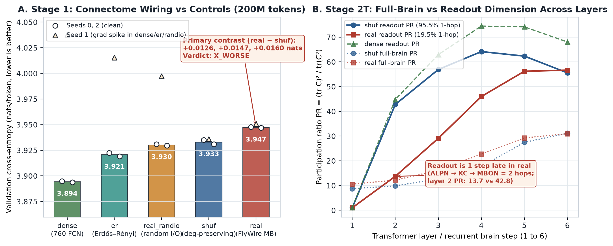
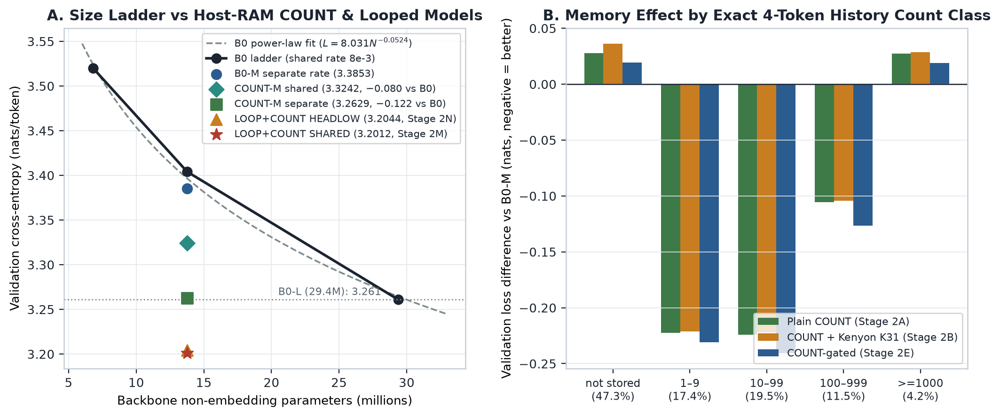
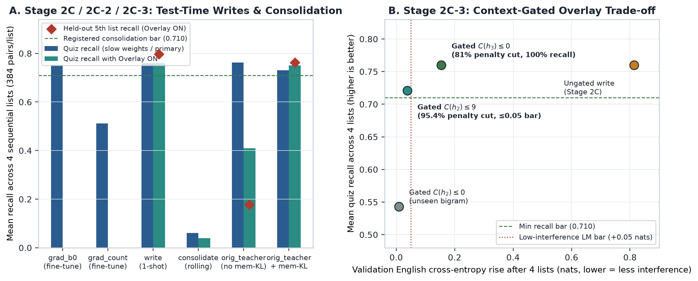
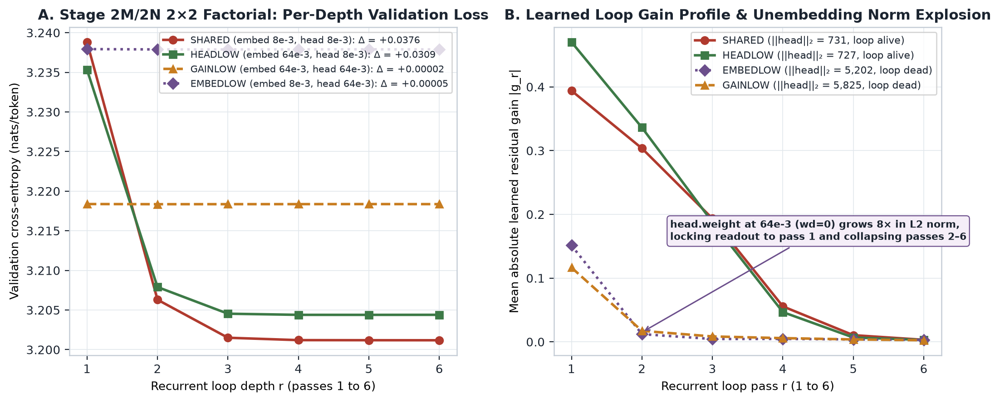

# connectome-lm

[](https://doi.org/10.5281/zenodo.24296168)

**From Connectome Wiring to Counted Memory and Recurrent Depth: Pre-Registered Tests of *Drosophila* Mushroom-Body Principles in Small Language Models**

*Author: Nate Farrow (Independent Researcher) · November 2026 · DOI: [`10.5281/zenodo.24296168`](https://doi.org/10.5281/zenodo.24296168)*

- **Permanent Zenodo Record (DOI):** [`https://doi.org/10.5281/zenodo.24296168`](https://doi.org/10.5281/zenodo.24296168)
- **Full Paper (PDF):** [`paper/connectome-lm-paper.pdf`](paper/connectome-lm-paper.pdf)
- **Interactive Web Manuscript (HTML + SVG):** [`https://pyrus117.github.io/connectome-lm/paper/`](https://pyrus117.github.io/connectome-lm/paper/) ([`paper/index.html`](paper/index.html))
- **Full Paper (Markdown with Figures):** [`PAPER.md`](PAPER.md)
- **LaTeX Source (arXiv / Overleaf):** [`paper/main.tex`](paper/main.tex)
- **Stage-by-Stage Lab Notes:** [`notes/`](notes/)
- **Machine-Readable Results:** [`runs/analysis.json`](runs/analysis.json) & [`results/`](results/)

---

## Overview

Across **16 pre-registered stages** (101 production training and evaluation runs, **25 registered predictions `P1`–`P25`**, and a **218-mutant automated test audit**), this repository tests where *Drosophila* mushroom-body principles help—and where they fail—in small language models (5M–29M parameters trained on 200M tokens of FineWeb-Edu):

1. **Part I — Literal Connectome Wiring vs Controls (`Stages 1 & 2T`):** Replacing a 6-layer transformer's FFNs with a shared recurrent reservoir wired like the adult *Drosophila* mushroom body (FlyWire v783: 6,293 neurons, 570,682 synapses, `data/mb_alpn_783.npz`) performs **reliably worse** than degree-preserving random shuffles (`real − shuf = +0.0126, +0.0147, +0.0160` nats/token, verdict `X_WORSE`) and dense or Erdős–Rényi controls (`dense < er < real_randio ≈ shuf < real`). While `real` has half the effective rank of its shuffles (`0.48×`), its full-brain activity participation ratio matches the shuffles (`real ÷ shuf = 1.00`, refuting `P1`); instead, its two-hop anatomical routing ($\text{ALPN} \to \text{KC} \to \text{MBON}$) leaves only **19.5%** of readout neurons one hop from an input (versus **95.5%** in shuffles), delaying readout dimensionality by one recurrent step.
2. **Part II — Host-RAM `COUNT` Memory, Leave-One-Out, and Fly-Hash Backoff (`Stages 2.0–2B, 2E–2K2`):** Replacing literal connectome simulation with a counted host-RAM $n$-gram memory (**COUNT**, orders 2–5 over 881M tokens, 5.15 GiB host RAM, zero GPU parameters) and online **leave-one-out (`LOO`)** subtraction (which prevents a **+0.84-nat** validation collapse from target leakage) lowers `13.8M`-parameter (`Size M`) validation loss by **−0.1224 nats** on equally tuned separate learning rates (`3.3853 → 3.2629`, `X_BETTER`, `P12`–`P13`), matching a **29.4M-parameter (`Size L`)** baseline (`3.2610`) at `+3.4%` step time and zero additional VRAM. A mushroom-body similarity backoff (`Kenyon K31`) improves an offline $n$-gram model on unseen histories (`−0.0151` nats, `P5` supported), but that gain vanishes inside the neural network (`+0.0046` nats vs plain COUNT, `P4` refuted). Learned gates and scalar controls (`Stages 2E, 2K, 2K2`) also fail to beat plain COUNT once `head.weight` trains at `64e-3` (`P19`–`P20` refuted).
3. **Part III — Complementary Learning Systems: One-Shot Writes, Consolidation, and `GatedOverlay` (`Stages 2C, 2C-2, 2C-3`):** Gradient-free one-shot count writes (`Overlay`) learn 4 sequential lists of 384 cue–answer pairs (`1,536` pairs) with **0.760 recall** and **0.000 backward forgetting** (`P7` supported). We diagnose two distinct failures in sequential KL-replay consolidation—**rolling-teacher drift** (`Stage 2C-2`, `+0.704` recall recovery with an untouched teacher) and **overlay-channel de-calibration** (`Stage 2C-3`, `H1a` supported)—and fix both with a **memory-on KL consistency loss** (`0.731` memory-off recall, `0.750` memory-on recall, `0.763` unseen 5th-list recall). Furthermore, gating test-time overlay writes by stored $n$-gram history counts (`GatedOverlay`) preserves **100% of quiz recall (`0.7602`) while cutting English validation loss interference by 81.0%** at $C(h_3)\le 0$, and cuts interference by **95.4% (`+0.038` nats)** at $C(h_2)\le 9$.
4. **Part IV — Recurrent Depth, Halting Frontiers, and the `head.weight` Norm Collapse (`Stages 2D, 2H–2I, 2L–2N`):** Adding a learned per-pass per-channel residual gain (`loop_gain`) and all-depth supervision (`Stage 2H`, `P17` supported) lowers `LoopGPT` validation loss by **−0.0384 nats** (`3.3720 → 3.3336`) and learns to damp passes 5–6 to zero automatically, so fixed depth 3 captures **99.2%** of the 6-pass gain. While the non-causal per-token oracle satisfies DeepSeek's affine effort law (`P9` supported) with `0.0626` nats of headroom, causal halting rules (`Stage 2I`, `P18` refuted) explain `< 1%` of pass-1 gain variance (`+0.0034` nats for ridge probes; `−0.0305` nats `X_WORSE` for entropy exit). Finally, through a `2×2` factorial (`Stages 2M–2N`, `P22`–`P25`), we prove that training the untied `head.weight` at `64e-3` with zero weight decay causes an **8× L2 norm explosion (`>5,200` vs `~730`)** that locks the shared readout to pass 1 and kills recurrent depth. Restraining `head.weight` to `8e-3` (`SHARED` and `HEADLOW`) revives the loop (`+0.0376` and `+0.0309` nats loop benefit) and achieves **`3.2012` nats** (`3.2015` at depth 3)—a **−0.2029 nat** reduction below the `B0-M` baseline (`3.4041`).

---

## Key Figures

| Stage 1 & 2T: Connectome Wiring & Readout Delay | Stage 2: Size Ladder & History Frequency Classes |
|---|---|
|  |  |
| **Stage 2C–2C-3: Test-Time Writes, Consolidation & `GatedOverlay`** | **Stage 2M–2N: `2×2` Factorial on `head.weight` Collapse** |
|  |  |

---

## Verification & Reproducibility

Run the full unit test suite and the 218-mutant automated mutation audit:

```bash
python -m pytest tests
python scripts/mutation_audit.py
```

Regenerate all publication figures from the committed `runs/analysis.json` and `results/stage2*.json` files:

```bash
python scripts/render_architecture.py
python scripts/render_paper_figures.py
```
